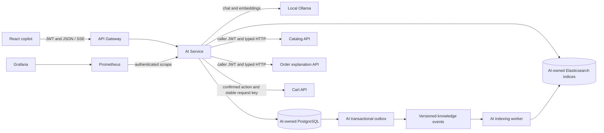
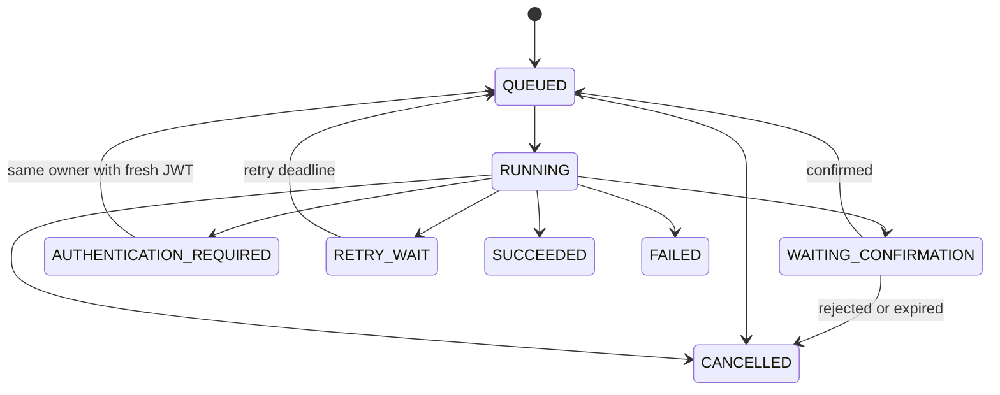

# CommerceFlow generative AI and agentic systems implementation plan

<!-- TOC START -->

## Table of contents

- [1. Outcome and release scope](#1-outcome-and-release-scope)
- [2. Decisions and compatibility gates](#2-decisions-and-compatibility-gates)
- [3. Target architecture and boundaries](#3-target-architecture-and-boundaries)
- [4. Identity, authority and confirmation contracts](#4-identity-authority-and-confirmation-contracts)
    - [Roles and modes](#roles-and-modes)
    - [Model requests versus application actions](#model-requests-versus-application-actions)
- [5. Proposed persistence, APIs and recovery semantics](#5-proposed-persistence-apis-and-recovery-semantics)
    - [AI-owned data model](#ai-owned-data-model)
    - [Proposed HTTP surface](#proposed-http-surface)
    - [Durable run state machine](#durable-run-state-machine)
    - [Cart concurrency and ambiguous outcomes](#cart-concurrency-and-ambiguous-outcomes)
- [6. Implementation phases and dependencies](#6-implementation-phases-and-dependencies)
    - [A0: Baseline, compatibility, model selection and architecture record](#a0-baseline-compatibility-model-selection-and-architecture-record)
    - [A1: AI module, persistence, security and command APIs](#a1-ai-module-persistence-security-and-command-apis)
    - [A2: Authoritative order explanations](#a2-authoritative-order-explanations)
    - [A3: Curated knowledge ingestion and lexical retrieval](#a3-curated-knowledge-ingestion-and-lexical-retrieval)
    - [A4: Embeddings, hybrid retrieval and grounded generation](#a4-embeddings-hybrid-retrieval-and-grounded-generation)
    - [A5: Typed, authorized read tools](#a5-typed-authorized-read-tools)
    - [A6: Durable bounded orchestration and streaming](#a6-durable-bounded-orchestration-and-streaming)
    - [A7: Confirmed cart changes and action reconciliation](#a7-confirmed-cart-changes-and-action-reconciliation)
    - [A8: React copilot experience](#a8-react-copilot-experience)
    - [A9: Evaluation, security/failure coverage and observability](#a9-evaluation-securityfailure-coverage-and-observability)
    - [A10: Compose, model profiles and non-destructive startup](#a10-compose-model-profiles-and-non-destructive-startup)
    - [A11: kind deployment, persistence and recovery](#a11-kind-deployment-persistence-and-recovery)
    - [A12: CI, documentation, demonstration and final audit](#a12-ci-documentation-demonstration-and-final-audit)
- [7. Planned file changes](#7-planned-file-changes)
- [8. Planned validation commands and evidence](#8-planned-validation-commands-and-evidence)
- [9. Final AI acceptance matrix](#9-final-ai-acceptance-matrix)
- [10. Current blockers and next action](#10-current-blockers-and-next-action)
- [Implementation evidence: 2026-10-18](#implementation-evidence-2026-10-18)
    - [A0 completed](#a0-completed)
    - [A1 foundation verification](#a1-foundation-verification)
    - [A2 verified](#a2-verified)
    - [A3 verified](#a3-verified)
    - [A4 verified](#a4-verified)
    - [A5 verified](#a5-verified)
    - [A6 verification](#a6-verification)
    - [A7 verified](#a7-verified)
    - [A8 verified](#a8-verified)
    - [A9 development evidence (release requirements remain open)](#a9-development-evidence-release-requirements-remain-open)
    - [A9 follow-up evidence and corrections](#a9-follow-up-evidence-and-corrections)
    - [Existing-volume provisioning and baseline Compose prerequisite verified](#existing-volume-provisioning-and-baseline-compose-prerequisite-verified)
    - [A9 completed repeated hybrid run (grounding review remains open)](#a9-completed-repeated-hybrid-run-grounding-review-remains-open)
    - [A10 host-mode source and runtime verification](#a10-host-mode-source-and-runtime-verification)
    - [A10 real process recovery, CPU runtime and off transition](#a10-real-process-recovery-cpu-runtime-and-off-transition)
    - [A11 source validation and runtime attempt](#a11-source-validation-and-runtime-attempt)
    - [A11 verified native-model deployment and recovery; CPU capacity gate open](#a11-verified-native-model-deployment-and-recovery-cpu-capacity-gate-open)
    - [A12 implemented and locally verified; final release requirements explicit](#a12-implemented-and-locally-verified-final-release-requirements-explicit)

<!-- TOC END -->

Created/implemented: 2026-10-18. Status: local Llama implementation and native-model Compose/kind
demonstrations verified; factual-review, full CPU/hardware and remote-CI release requirements remain
open. See the current blocker section, dated phase evidence and
[retained results](docs/ai-results/). The [prerequisite assessment](docs/ai-prerequisites.md) is the
historical baseline before model download/implementation.

This user-requested extension follows `CODEX_PROMPT.md` and the original 13-phase plan in
[PLAN.md](PLAN.md). It preserves the original service boundaries, security, consistency and testing
requirements. Update the original deployment checks only when execution evidence supports them.
Leave the remaining acceptance requirements open. Check a task only after its implementation and
stated verification pass. After each phase, record the commands, reports, model identities and
blockers.

## 1. Outcome and release scope

Build an independently deployable Java/Spring `ai-service` that powers an authenticated CommerceFlow
copilot. Demonstrate generation, retrieval, typed tool use, durable orchestration, evaluation,
observability and local deployment.

The first release has two increments:

| Increment              | User-visible behavior                                                                                                                                                                            | Release gate                                                                                           |
|------------------------|--------------------------------------------------------------------------------------------------------------------------------------------------------------------------------------------------|--------------------------------------------------------------------------------------------------------|
| Read-only copilot      | Answer curated demo-policy questions with citations; find/compare products; explain an owned order using current service data. A SUPPORT mode can read explicitly authorized order explanations. | A0 to A6 and the read-only portion of A8; security/evaluation gates in A9; deployment evidence in A10. |
| Confirmed cart actions | Propose an exact cart change, show its effects, obtain confirmation and execute the approved operation once within the documented retry window.                                                  | A7 to A10, plus A11 to A12 for complete kind/CI/final acceptance.                                      |

Representative demonstrations:

1. “Find a keyboard under $150 and explain the differences.” Return only actual product matches with source links.
2. “Why was my order cancelled?” Fetch the caller's owned order and its authoritative public explanation.
3. “What does the demo return policy say?” Retrieve the applicable versioned sample document and cite its sections.
4. “Add two of the first keyboard to my cart.” Resolve the selected product, show a specific proposal, then execute
   only when the user confirms that proposal.
5. Pause on a proposal, restart `ai-service`, sign in again and resume without duplicating a cart mutation.

Policy fixtures must be labeled synthetic demonstration policies. Do not invent shipping promises,
return eligibility, stock availability or payment explanations. Checkout stays in the existing UI
and order saga. Autonomous order creation, payment/refund operations, stock/product edits, shell/SQL
tools, arbitrary URL fetching and operations remediation are outside this release. Multi-agent
coordination, MCP exposure and hosted inference are later extensions.

## 2. Decisions and compatibility gates

| Area             | Planned decision                                                                                                            | Verification before pinning/acceptance                                                                                                                                                                   |
|------------------|-----------------------------------------------------------------------------------------------------------------------------|----------------------------------------------------------------------------------------------------------------------------------------------------------------------------------------------------------|
| Application      | Java 25, current Boot 4.1.x baseline, new Maven `ai-service`                                                                | Build the entire reactor without independently replacing Boot-managed Spring components.                                                                                                                 |
| AI framework     | Spring AI 2.0.x; 2.0.1 is the candidate documented stable release at planning time                                          | Resolve artifacts, inspect the effective dependency tree, test Jackson/Elasticsearch/HTTP client compatibility and real tool calls. Documentation compatibility alone is insufficient.                   |
| Models           | Local Ollama; one tool-capable quantized chat model plus one embedding model                                                | Select exact runtime version, model names, immutable digests, licenses, embedding dimension and context settings in A0. Test capabilities on the actual Mac; no model size/latency guarantee is assumed. |
| Retrieval        | Existing catalog API for live products; AI-owned Elasticsearch indices for curated documents, lexical first and then hybrid | Preserve catalog index ownership; compare retrieval results against a labeled corpus before accepting semantic retrieval.                                                                                |
| Persistence      | New owned PostgreSQL `ai` database/user with Flyway                                                                         | Separate credentials; only AI-owned tables. No foreign-service SQL.                                                                                                                                      |
| Orchestration    | One agent, explicit Java state machine, durable steps and bounded tool execution                                            | Verify retries, timeouts, competing workers, authentication loss and restart recovery.                                                                                                                   |
| User transport   | JSON commands/status plus authenticated fetch-based SSE for progress                                                        | Exercise gateway/frontend streaming, reconnect and JWT expiry. Tokens must not appear in URLs.                                                                                                           |
| Local deployment | Optional AI profile; native Ollama preferred on macOS, opt-in CPU container alternative                                     | Measure total host memory and verify model reachability from application containers.                                                                                                                     |

Official references checked while planning:

- [Spring AI getting started](https://docs.spring.io/spring-ai/reference/getting-started.html): 2.0.x documents Boot
  4.0.x/4.1.x support and a separate AI BOM.
- [Spring AI tool calling](https://docs.spring.io/spring-ai/reference/api/tools.html): the application executes tools;
  the framework's automatic loop must be configured or adapted to enforce this plan's limits and confirmation boundary.
- [Spring AI Elasticsearch](https://docs.spring.io/spring-ai/reference/api/vectordbs/elasticsearch.html): vector storage
  and metadata filtering; verify compatibility with this project's actual Elasticsearch/client versions.
- [Ollama tool calling](https://docs.ollama.com/capabilities/tool-calling): test actual selected-model support.
- [Ollama FAQ](https://docs.ollama.com/faq): Docker Desktop on macOS lacks GPU acceleration; native/container network
  access, memory/context settings and local-only operation require deliberate configuration.

Use no paid cloud resources or real customer data. Record final pins and evidence in
`docs/dependencies.md` during A0. The original planning task installed no framework/model/image. The
subsequent prerequisite audit resolved candidate AI dependencies in an ignored isolated probe,
without changing production POMs or downloading models/images.

## 3. Target architecture and boundaries



- PostgreSQL stores AI workflow state; Redis is not its durable memory authority. Model inference and HTTP calls happen
  outside database transactions. Persist intent/checkpoints in short local transactions.
- `ai-service` reads catalog/orders/carts through owned service APIs. It never loads another service's repository,
  database credentials or JPA entities. `contracts` receives only versioned shared wire records where needed.
- Only public curated knowledge is embedded for the first release. Personal order/payment data is fetched on demand
  under the caller's JWT and is never added to a shared vector index or cross-user answer cache.
- Catalog prices in generated text are informational snapshots with timestamps. Fresh catalog reads and the existing
  Order Service remain authoritative. Do not expose the ADMIN inventory API as a customer availability tool.
- Knowledge indexing uses the AI service's own outbox and idempotent projection worker. Kafka is not required for
  every conversation turn; background ingestion must not create a second checkout orchestration path.

Proposed package layout under `com.commerceflow.ai`: `api`, `application`, `domain`, `persistence`,
`model`, `retrieval`, `tools`, `indexing`, `security`, `observability`. Use concrete records/classes
and small interfaces around provider/HTTP boundaries; do not build a general-purpose agent
framework.

## 4. Identity, authority and confirmation contracts

### Roles and modes

| Conversation mode | Allowed identity                                  | Tools available                                                                                                                                    |
|-------------------|---------------------------------------------------|----------------------------------------------------------------------------------------------------------------------------------------------------|
| CUSTOMER          | CUSTOMER or ADMIN acting on their own resources   | Knowledge/product reads, owned order explanations, own cart reads; cart proposals after A7.                                                        |
| SUPPORT           | SUPPORT or ADMIN explicitly choosing support mode | Public knowledge/product reads and the new scoped administrative order explanation read. No customer cart actions or payment/admin mutation tools. |

The server selects the mode/tool registry from verified roles and explicit UI mode, never model
text. Every conversation, run, event stream and proposal has an owner derived from JWT `sub`. A role
granting access to an order does not grant access to another user's AI conversation. ADMIN's
ordinary customer mode still uses ownership checks.

User tools forward the current caller token to the owning API, which independently authorizes each
operation. Never substitute the broad `commerceflow.internal` service credential to make a denied
user call succeed. The shared security configuration currently has a special SUPPORT rule only for
`GET /api/v1/admin/orders`; explicitly add/test the new support explanation route without broadening
all administrative access.

Do not persist access/refresh tokens, send credentials to the model, or place them in tool
arguments/logs. Keep the short-lived execution credential in process memory, associated with
run/subject and token expiry. A restart or expiry transitions credential-dependent work to
`AUTHENTICATION_REQUIRED`. Resuming requires a fresh caller JWT with matching subject and current
roles; never silently elevate privileges or reuse a signed-out browser session for a write.

### Model requests versus application actions

The model can request read tools and prepare a proposed cart action. It cannot call the confirmation
endpoint or a mutating backend tool directly. A typed application executor performs a confirmed
action without asking the model to rewrite its arguments. Product UUID, quantity, operation, cart
revision and action hash are displayed/validated by code.

Confirmation binds the proposal ID/version, owner, mode, canonical arguments hash, target and
expiry. A changed cart, changed arguments, expired proposal or changed authorization invalidates it.
A normal chat reply such as “yes” does not bypass the explicit confirmation endpoint. Confirmation
and rejection are auditable state transitions.

## 5. Proposed persistence, APIs and recovery semantics

### AI-owned data model

| Table                               | Important fields / integrity                                                                                                                                        |
|-------------------------------------|---------------------------------------------------------------------------------------------------------------------------------------------------------------------|
| `ai_conversations`                  | UUID, owner subject, mode, title, status, version, UTC timestamps; indexed owner/updated time.                                                                      |
| `ai_messages`                       | Conversation FK, ordered sequence, role, bounded content, status, run FK; unique conversation/sequence.                                                             |
| `ai_runs`                           | Conversation/input message, request key/hash, state, model/prompt/toolset versions, deadlines, limits, lease/fencing version, error code; unique owner/request key. |
| `ai_run_steps`                      | Run FK, sequence, step kind/status, sanitized input/result, attempts, duration and usage; unique run/sequence. Persist completed tool results for recovery.         |
| `ai_run_events`                     | Run FK, monotonic sequence and bounded UI event payload; unique run/sequence for SSE replay. No hidden chain-of-thought or credentials.                             |
| `ai_action_proposals`               | Run/owner, typed operation/arguments hash, expected opaque cart revision, state, expiry, confirmation time and version.                                             |
| `ai_action_executions`              | Unique proposal/operation ID, stable downstream request key/hash, attempts, started time, outcome/result/error, deduplication deadline.                             |
| `knowledge_documents`               | Stable source ID, source version/hash, audience/classification, effective dates, active/tombstone status and content; only curated local Markdown/text initially.   |
| `knowledge_chunks`                  | Document/version FK, deterministic chunk ID, offsets/heading/content hash, embedding model/dimension and indexing state; unique document/version/chunk ordinal.     |
| `knowledge_index_jobs`              | Document version, phase/status, retry deadline/attempts, target index generation and error; unique document/version/index generation.                               |
| `outbox_events`, `processed_events` | Existing local durability conventions for knowledge-change/index events. Mark projection completion only after the external index effect is acknowledged.           |

Set foreign keys, check constraints, optimistic versions, bounded JSON/text fields and operational
indexes. Store model identity, prompt hash and selected source IDs with a run so an evaluation/audit
can reproduce its configuration. Initial retention targets: 7 days for conversation content and 30
days for sanitized run/action audit metadata; implement as configurable, documented cleanup with
operator opt-in. Deletion must cancel pending work and remove associated derived data without
deleting business orders/carts. No automatic deletion is authorized by writing this plan.

### Proposed HTTP surface

All write commands use canonical request hashes/idempotency where applicable, typed records, Bean
Validation, ProblemDetail, UTC timestamps and correlation IDs. All user endpoints require JWTs and
ownership checks.

| Endpoint                                      | Contract                                                                                                                    |
|-----------------------------------------------|-----------------------------------------------------------------------------------------------------------------------------|
| `GET /api/v1/ai/capabilities`                 | Authenticated; available modes/features/model readiness and configured limits, without exposing internal addresses/secrets. |
| `POST /api/v1/ai/conversations`               | `{mode}` + request key; returns owned conversation.                                                                         |
| `GET /api/v1/ai/conversations`                | Owned paginated list.                                                                                                       |
| `GET /api/v1/ai/conversations/{id}/messages`  | Owned paginated history; bounded message DTOs and citations.                                                                |
| `POST /api/v1/ai/conversations/{id}/messages` | `{content}` + request key; atomically records user message and queued run; returns 202 with run location.                   |
| `GET /api/v1/ai/runs/{id}`                    | Current state, public progress, results, proposals and structured errors.                                                   |
| `GET /api/v1/ai/runs/{id}/events`             | Fetch-based SSE, bearer header and `Last-Event-ID`; ordered replay with per-owner authorization.                            |
| `POST /api/v1/ai/runs/{id}/resume`            | Fresh caller authorization + request key; resumes eligible paused work. Does not itself approve a proposal.                 |
| `POST /api/v1/ai/runs/{id}/cancel`            | Idempotently stops future work; an already-issued downstream operation may still complete and must be reconciled.           |
| `POST /api/v1/ai/proposals/{id}/confirm`      | `{version, argumentsHash}` + request key; single-use confirmation and durable execution intent.                             |
| `POST /api/v1/ai/proposals/{id}/reject`       | Idempotent rejection; invalidates further execution.                                                                        |
| `POST /api/v1/admin/ai/knowledge/imports`     | ADMIN only, bounded curated text/document metadata with source/version/hash; no arbitrary URL fetching.                     |
| `GET /api/v1/admin/ai/knowledge/jobs/{id}`    | ADMIN, ingestion/indexing progress and sanitized failure.                                                                   |
| `POST /api/v1/admin/ai/knowledge/rebuilds`    | ADMIN, request key; asynchronous versioned rebuild/alias swap.                                                              |
| `GET /api/v1/orders/{id}/explanation`         | New owned Order Service API returning public state/reason/history; CUSTOMER/ADMIN, other owner -> 404.                      |
| `GET /api/v1/admin/orders/{id}/explanation`   | New Order Service read for ADMIN/SUPPORT; explicitly authorized, sanitized DTO.                                             |

Recommended errors include `AI_DISABLED`, `AI_MODEL_UNAVAILABLE`, `AI_CAPACITY_EXCEEDED`,
`AI_RUN_LIMIT_REACHED`, `AI_AUTHENTICATION_REQUIRED`, `AI_PROPOSAL_EXPIRED`, `AI_APPROVAL_STALE`,
`AI_ACTION_OUTCOME_UNKNOWN` and standard ownership/idempotency errors. Use 503 for unavailable
inference, 429 for bounded admission, 409 for stale/conflicting actions, 404 for inaccessible owned
resources, and normal 401/403 authentication/role semantics.

### Durable run state machine



Use `SELECT ... FOR UPDATE SKIP LOCKED` to claim short leases and a monotonically increasing fencing
version to reject stale worker commits. Persist a step intent before dispatch and its result after
acknowledgment; do not keep a transaction/row lock open during inference or HTTP. Serialize active
runs per conversation to preserve message order; reject a second concurrent message with a clear
conflict until the active run is terminal. Paused runs release workers.

Checkpoint only safe observable artifacts: selected evidence, model tool requests, tool results,
proposals and final answers. A crash during model generation can regenerate an incomplete answer;
never promise byte-for-byte LLM replay. Completed tools reuse durable results where fresh data is
not required. Customer-specific data and approval preconditions must be refreshed before execution.
Partial tokens are previews; persist committed final content and bounded progress events. A
reconnect may receive a replacement preview after a crash, identified by attempt ID.

Proposed initial limits, to tune using actual measurements: one concurrent model request, at most 8
queued runs, 4 model rounds and 8 tool calls per run, 120 seconds active execution time, 45 seconds
per model call, 5 seconds per ordinary tool call, at most 2 transient retries, 4,000 user characters
and 6 retrieved chunks. Pause time does not consume active execution time. Proposals expire after 5
minutes; authentication pauses expire after 15 minutes. Token/context budgets must fit the selected
model; truncate by dropping whole older messages/evidence, never authorization context.

### Cart concurrency and ambiguous outcomes

The current cart has a numeric version and 24-hour Redis request memos, but no conditional mutation
API. Before AI writes, add an opaque cart revision/ETag with an incarnation UUID plus counter and
optional `If-Match` support for existing clients; AI execution must always supply it. An incarnation
prevents an expired/recreated cart from matching an old numeric version. Lua must check an existing
matching request memo before its revision precondition so a lost-response retry returns the original
result. A mismatched request hash still fails.

Confirm under a PostgreSQL lock, persist one execution ID/key, commit, then call Cart outside the
transaction. All retries and competing workers use the same key and exact arguments. If the response
is lost, reconcile/retry only inside the known downstream memo-retention horizon and with the same
cart incarnation/preconditions. Configure the maximum automatic recovery window to be shorter than
the cart memo TTL. If Redis state or memo validity is uncertain, record `OUTCOME_UNKNOWN`, show
current cart state and require review; do not invent success or retry with a new key. Cancellation
cannot undo a request already sent. Never describe this cross-store workflow as distributed
exactly-once.

## 6. Implementation phases and dependencies

Follow the phases in order. UI shell work may start earlier, but each acceptance check depends on
the preceding verified behavior. Implement security and tests, and collect operational evidence
throughout the work; do not defer them until A9.

### A0: Baseline, compatibility, model selection and architecture record

Depends on: original CommerceFlow implementation/source baseline and the existing verification
record.

- [x] Re-run the baseline Java/frontend checks; record actual current results rather than treating historical 43/2/4
  counts as a new execution. Inspect available Docker/kind/Ollama and machine memory/disk.
- [x] Resolve candidate Spring AI dependencies with the current Boot BOM; inspect Elasticsearch, Jackson and HTTP
  dependencies. Do not downgrade existing services or pin incompatible transitive Spring versions.
- [x] Run a real local chat, structured tool request and embedding request. Choose one runtime/chat/embedding set;
  record digests, license, context/quantization settings, memory and measured cold/warm behavior.
- [x] Define versioned prompt/tool schemas and a labeled synthetic evaluation corpus before prompt tuning; freeze a
  holdout subset. Include owned-order, knowledge, product and adversarial examples.
- [x] Write `docs/adr/0002-ai-copilot.md`, update dependency evidence and record initial limits/configuration.

Acceptance: baseline passes or precise existing failures/blockers are recorded; at least one real
compatible model configuration is demonstrated before any claim of working AI. If model execution is
unavailable, source work may continue under the original environment-limits rule, with all
real-model acceptance requirements open.

Prerequisite evidence (2026-10-18): fresh baseline 43 Java / 2 frontend unit / 4 Chrome tests,
frontend lint/build and Compose configuration pass. Isolated Boot 4.1.1 / Spring AI 2.0.1
resolution/compilation/classloading and Jackson 3 serialization pass, with Elasticsearch client
9.4.5 retained. No real-model call was possible because Ollama has no downloaded models. A0 remains
incomplete. Exact results/limits: [prerequisite assessment](docs/ai-prerequisites.md).

### A1: AI module, persistence, security and command APIs

Depends on: A0 compatibility/architecture decisions.

- [x] Add `ai-service/pom.xml`, application/configuration, typed API/domain/service/persistence packages and service
  executable packaging; preserve independently deployable existing modules.
- [x] Add Flyway migrations, owned `ai` database/user provisioning, bounds/constraints/indexes and schema validation.
  Provide an explicit additive database provisioning command for already-initialized volumes; never require `down -v`.
- [x] Implement owned conversations/messages/runs, canonical request hashes and one-active-run concurrency control.
- [x] Add CUSTOMER/SUPPORT modes, explicit backend authorization rules and gateway routing/configuration behind
  `AI_ENABLED`. Keep disabled AI from breaking existing gateway/storefront health or startup.
- [x] Implement capabilities/status, consistent errors/correlation, health/metrics and generated OpenAPI contracts.

Verification: real PostgreSQL migration/rollback tests; concurrent same-key commands create one
message/run; changed content conflicts; all endpoints reject cross-owner access, wrong
issuer/audience and unauthorized modes.

Acceptance: durable secured command/status APIs work through the real gateway without requiring
model availability for baseline commerce functionality.

### A2: Authoritative order explanations

Depends on: A1 and the unchanged existing saga invariants.

- [x] Add an Order Service migration for ordered status history/public reason codes. Record initial creation,
  transitions, user cancellation, stock rejection, payment decline and timeout reconciliation in their local
  transactions with existing business state/outbox intent.
- [x] Centralize public reason mapping; do not expose raw exceptions, payment details or internal saga error text.
  Record customer-safe codes such as `PAYMENT_DECLINED`, `INSUFFICIENT_STOCK`, `PAYMENT_TIMEOUT`, `CUSTOMER_CANCELLED`.
- [x] Implement owned/admin explanation endpoints and DTOs with current version/state, reason availability, relevant
  timestamps and bounded history. Legacy orders without history return an explicit unknown/unavailable reason;
  migrations must not fabricate historical causes.
- [x] Add explicit SUPPORT authorization only to the intended new administrative GET route. Customer explanation
  tools must never fall back to the ADMIN payment endpoint.

Verification: real successful/declined/stock/timeout/late-payment workflows; HTTP ownership and role
checks; rollback and duplicate-event history deduplication; existing saga/concurrency suite still
passes.

Acceptance: “why cancelled” can be answered from an authorized, durable source. Missing history is
reported honestly.

### A3: Curated knowledge ingestion and lexical retrieval

Depends on: A1 to A2; A0 corpus definition.

- [x] Add `knowledge/` synthetic policy/product-guide/runbook fixtures with IDs, versions, audience, effective dates
  and provenance. Only the appropriate audience is retrievable in each conversation mode.
- [x] Implement bounded Markdown/text import, deterministic section-aware chunking and content hashes; no external
  crawler, uploaded executable processing or unbounded file ingestion.
- [x] Persist document versions/chunks and a knowledge-change outbox event atomically. Add versioned event DTO/topic
  and explicit outbox routing rather than overloading order/catalog events.
- [x] Implement a replay-safe indexing worker and jobs. Index with source-version protection; handle a crash between
  Elasticsearch acknowledgment and database completion by safe reindexing, not by assuming a distributed commit.
- [x] Create AI-owned explicit mappings/read-write aliases; implement filtered BM25 retrieval, citations with source
  version/chunk/heading, deactivation/deletion and a paged full rebuild from the AI-owned source database.
- [x] Serialize/fence rebuild and live indexing so concurrent document updates/tombstones cannot be lost or resurrected
  after alias swap. Return citations only to authorized sources and a version that was actually retrieved.

Verification: real PostgreSQL/Kafka/Elasticsearch ingestion/replay/outage tests; unchanged import
idempotency, changed version activation, stale rejection, tombstones, audience filtering and
concurrent rebuild/indexing tests.

Acceptance: useful lexical evidence and valid source references are available without an
embedding/model dependency; an indexing outage retains recoverable work and is reported as
stale/unavailable rather than hidden.

### A4: Embeddings, hybrid retrieval and grounded generation

Depends on: A0 real embedding configuration and A3 verified lexical pipeline.

- [x] Generate embeddings with bounded batches/timeouts; record model digest/dimension and normalized text/chunk hash.
- [x] Add explicit vector mappings and versioned index generations. A changed embedding model/dimension requires a
  new generation and rebuild, not mixed vectors in an existing index.
- [x] Combine filtered lexical/vector candidates with a deterministic rank-fusion strategy; deduplicate sources and
  cap context. Document score semantics and compare against the lexical baseline.
- [x] Build prompts that treat retrieved documents/tool results as untrusted data. Restrict citation IDs to the
  server-provided source set; validate the structured final answer before rendering it.
- [x] Require abstention/clarification when evidence is absent or conflicting. Fetch product prices/active state via
  Catalog before presenting actionable choices; do not embed personal order data or synthesize policy eligibility.
- [x] Define explicit lexical fallback when embeddings fail and clear unavailability when generation itself fails.

Verification: real selected-model/embedding tests; dimension-change rebuild; prompt-injection
fixtures; citation-ID validation; holdout retrieval/grounding evaluation and absent-evidence
responses. No claim of semantic improvement unless measured against the same corpus/baseline.

Acceptance: grounded answers with working citations and measured retrieval quality; failures produce
honest degraded responses and never silently call a paid/cloud model.

### A5: Typed, authorized read tools

Depends on: A2 order explanations and A4 generation/retrieval.

- [x] Implement role/mode-specific allowlists: `searchProducts`, `getProduct`, `getMyOrderExplanation`, `getMyCart`,
  `searchKnowledge`; SUPPORT additionally has an explicitly scoped `getSupportOrderExplanation` read.
- [x] Validate JSON schemas, unknown fields, UUIDs, paging, quantities and bounded outputs. Identity, roles, tokens,
  URLs and customer IDs are server execution context, never model-controlled authority parameters.
- [x] Use fixed configured service targets, caller-token forwarding, timeouts and correlation IDs. Do not expose
  generic HTTP, SQL, filesystem, shell or dynamic tool registration to the model.
- [x] Normalize downstream errors without leaking inaccessible-resource existence or internal credentials. Return
  selected DTO fields with timestamps/source references; keep raw service diagnostics out of model context.
- [x] Register tools through Spring AI with application-enforced validation/dispatch; prove that its automatic tool
  loop cannot bypass orchestration budgets, checkpointing or the future confirmation boundary.

Verification: actual HTTP calls to real secured services; real-model tool-choice checks; negative
tests for arbitrary targets, cross-owner UUIDs, admin payment/stock access, role changes and
malformed tool arguments.

Acceptance: the copilot can investigate a question through multiple authorized read calls without
broader authority than the user. SUPPORT access never unlocks cart/customer actions.

### A6: Durable bounded orchestration and streaming

Depends on: A1 data/state APIs and A5 verified tool dispatch.

- [x] Implement the explicit run/step state machine, admission/iteration/token/deadline budgets, bounded retries and
  one active run per conversation. Use virtual threads for suitable blocking I/O with separate inference admission.
- [x] Implement leases/fencing, checkpoint safe artifacts and resume/reconciliation for interrupted model/tool steps.
  Never hold a database transaction open during external calls.
- [x] Add in-memory credential attachment, expiry handling and fresh-token resume. A restart pauses privileged work
  until the same subject reauthenticates; no persisted JWT/refresh-token shortcut.
- [x] Implement ordered persisted progress/final-result events and fetch-based SSE replay, heartbeat, cancellation,
  backpressure and slow-client bounds. Disconnecting a stream must not enqueue a duplicate run.
  Bound stream lifetime by token expiry and require a fresh authorized reconnect; replay must not cross owners or
  continue exposing protected data after authentication expires.
- [x] On cancellation, prevent future steps and reconcile any already-issued request. A partial model answer is
  explicitly non-final; only a committed final message is presented as complete.

Verification: restart during generation/read tools, two competing workers, lease expiry, duplicate
messages, SSE reconnect/replay, token expiry and role change, queue saturation and slow/looping
model behavior.

Acceptance: read-only multi-step investigations finish or stop with an explicit bounded state and
recover after restart. Safe public progress is visible without exposing hidden model reasoning.

### A7: Confirmed cart changes and action reconciliation

Depends on: A5 to A6; read-only agent correctness before enabling any write capability.

- [x] Extend Cart's representation with an opaque incarnation-aware revision/ETag and atomic conditional mutations.
  Preserve current clients; require `If-Match` for AI execution. Check request memo/hash before revision in Lua.
  Define stable ETag issuance for empty carts under concurrent reads and a new incarnation after expiry/recreation;
  ordinary reads must not indefinitely extend the cart's TTL.
- [x] Add `proposeCartChange` as a prepare-only capability. Resolve ambiguous references through clarification and
  pin the exact operation/product/quantity, observed cart state, arguments hash and proposal expiry.
- [x] Implement confirm/reject APIs with current role/owner/mode verification, proposal optimistic locking and
  durable execution intent. Only the application's executor calls Cart; the model cannot confirm its own proposal.
- [x] Persist/reuse the downstream request key and recovery deadline. Reconcile timeout/lost acknowledgment with
  the same key; enforce the memo TTL window and avoid new-key retries on uncertain outcomes.
- [x] Invalidate stale/expired/rejected proposals; handle cart expiry/recreation, intervening UI changes and Redis
  outage/state uncertainty with reviewable errors. Persist an unknown outcome rather than asserting success.
- [x] Keep checkout, cancellation/refund and admin mutations outside the tool registry for this release.

Verification: 100 concurrent confirmations cause one cart effect; duplicate confirmation returns the
same execution; crash before call/after backend commit/before local result persistence; cart ABA
expiry; changed arguments; token expiry; stale revision; Redis outage and deduplication-window
expiry; all existing cart concurrency tests pass.

Acceptance: every mutation has an exact user-confirmed proposal and audit record; retries do not add
duplicate units within supported guarantees; ambiguous outcomes never trigger blind re-execution.

### A8: React copilot experience

Depends on: A6 for read-only UI; A7 before enabling action controls.

- [x] Add typed AI API/SSE clients and an accessible responsive panel with conversation history, message states,
  citations, product cards, structured tool progress and explicit final/error states.
- [x] Enable only server-reported authorized capabilities. Separate CUSTOMER/SUPPORT modes and clear private UI state
  on logout/account switch; reauthenticate/resume after token expiry without sharing history across users.
- [x] Render model Markdown as untrusted content with raw HTML disabled/sanitized and safe source links. Do not
  execute generated HTML/scripts or allow model-generated action buttons/URLs to bypass typed UI controls.
- [x] Display exact cart before/after proposal, quantity, revision/expiry and confirm/reject buttons. Disable repeat
  submissions, retain request keys after ambiguous failures and refresh the cart from the backend after execution.
- [x] Handle model warmup/unavailability, queue limits, offline/reconnect and unknown action outcomes with actionable
  messages. Preserve the storefront and checkout when AI is disabled or unavailable.

Verification: frontend lint/unit/build, accessible keyboard interactions, mobile viewport; real
browser PKCE, cited answer, order explanation, support restrictions, proposal confirmation,
logout/isolation and reconnect/restart flows.

Acceptance: the complete read-only and confirmed-action demonstrations work through the real
gateway/UI; users can always distinguish proposed actions, executed actions and incomplete/unknown
results.

### A9: Evaluation, security/failure coverage and observability

Depends on: A0 frozen fixtures and A4 to A8 behavior; extend checks continuously in earlier phases.

- [x] Build a versioned local evaluation harness with 80 labeled cases: 20 retrieval/citation, 20 product/order
  investigation, 20 tool/action/recovery, 20 authorization/injection/abstention. Reserve 20 cases as a holdout before
  tuning; maintain richer deterministic negative tests outside these model quality cases.
- [ ] Report retrieval recall@5, citation correctness/grounding, appropriate abstention, task completion, valid tool
  schemas, call counts, outcome uncertainty and latency. Prefer labeled facts/programmatic assertions plus documented
  human review for open-ended wording; do not require an external paid model judge.
- [ ] Enforce proposed release targets: retrieval recall@5 >= 90%, >= 95% supported factual assertions on grounded
  answer cases, >= 90% task completion over answerable cases, and zero unauthorized/unconfirmed business effects.
  All deterministic ownership/idempotency/limit tests must pass. These are targets, not measured results; document
  denominators and repeat real-model runs three times to expose variation.
- [x] Test malicious content in product descriptions/knowledge/tool outputs, forged citation/action IDs, resource
  exhaustion, cross-user history/cache access and caller-controlled endpoint/role arguments. Authorization remains
  code-enforced even if the model follows a malicious instruction.
- [x] Add Micrometer metrics for run/step/tool/model/retrieval latency, time-to-first-token, token usage when supplied,
  queue depth, active workers, indexing lag, citation failures, approvals and unknown outcomes. Keep prompts, JWTs,
  user IDs, run IDs and product IDs out of metric labels; content logging is disabled by default.
- [x] Provision a Copilot dashboard and alerts for queue saturation, inference failures, indexing backlog and stuck
  runs; retain correlation IDs and sanitized step/audit records.
- [x] Add separate warm/cold generation, retrieval, tool and end-to-end load scenarios. Record p50/p95/p99, memory,
  queueing, context/concurrency/model settings and baseline commerce impact. Set a regression budget after measuring
  repeatable baselines; do not invent an AI throughput/SLA target for the Mac.

Verification: deterministic/infrastructure/security suites plus separately reported real-model
holdout results; real Prometheus/Grafana samples and reproducible measured load artifacts. A
scripted model adapter may test failure branches in unit tests, but never counts as real-model
functionality/evaluation verification.

Acceptance: critical behavior passes with zero unsafe business effects, quality meets declared
thresholds, meaningful AI metrics are visible and capacity/degraded behavior is measured honestly.

### A10: Compose, model profiles and non-destructive startup

Depends on: A0 chosen runtime/models and A1 to A9 accepted source/native behavior. Full acceptance
also requires closing the original Compose startup/image verification checks from PLAN.md on a
Docker-enabled machine.

- [x] Add AI application multi-stage/nonroot image, environment configuration, owned PostgreSQL provisioning,
  gateway/Prometheus/Grafana integration and optional Compose profiles.
- [x] Extend `scripts/compose-up.sh` with a documented validated option contract:
  `--ai=off` (default, preserves current full-stack behavior), `--ai=host` and `--ai=container`.
  Host/off commands and standalone CPU preparation are executed; full CPU co-location is blocked by VM memory.
- [x] Host mode starts AI application services and checks a configured native Ollama endpoint. Verify network access
  from inside a container; resolve the exact host binding/proxy requirements rather than assuming a loopback listener
  is reachable through `host.docker.internal`. Keep access limited to the intended local host/VM network.
- [x] Container mode adds a pinned CPU Ollama runtime, model volume and explicit model provisioning/warmup step.
  Separate runtime health from “required models present”; verify digests before reporting model-ready.
- [x] Keep model downloads explicit with progress, disk checks and a configurable longer timeout; do not make the
  current 300-second application wait silently absorb multi-gigabyte model downloads.
- [x] Add feature-disable behavior, probe semantics and resource limits. Model unavailability must not make the
  entire commerce gateway unready; expose AI capability degradation and reject new AI work clearly.
- [x] Add an additive owned-role/database migration path for existing Compose volumes. Keep secrets in ignored local
  config and preserve existing volumes/data; startup never executes `down -v`.
- [ ] Measure memory for Docker, native models, OS and IDE together on the 32 GB target. Start with one inference
  slot and bounded context; reduce profiles/model/context if measured pressure requires it.

Verification: shell syntax/parser tests, profile/Compose configuration checks for all modes, actual
image builds, native-model reachability from container, CPU model startup/warmup, full browser demo,
AI-disabled startup, model outage, additive provisioning on an existing volume and
application/infrastructure restart persistence.

Acceptance: both documented local inference modes run as described or a specific mode remains
unchecked with its blocker; standard CommerceFlow startup still works without AI or a downloaded
model.

### A11: kind deployment, persistence and recovery

Depends on: A10 image/runtime verification and the original kind deployment acceptance
prerequisites.

- [x] Add an optional Kustomize AI overlay with application Deployment/ClusterIP, owned credentials/config, probes,
  CPU/memory budgets, bounded-worker configuration and network policies for exact dependencies.
- [ ] Provide a CPU model StatefulSet/PVC and explicit digest-checked model provisioning Job for a self-contained
  kind demonstration. Keep model download/storage capacity and startup latency visible.
- [x] Use service DNS within the cluster. Native macOS GPU inference is an optional separately tested external
  endpoint mode; do not assume Apple GPU access from kind or hardcode `localhost` as its model address.
- [x] Extend image build/load/startup/diagnostics scripts and namespace monitoring; cap replicas/inference admission
  rather than scaling AI workers beyond model/database capacity.
- [x] Verify read/model/network permissions with an enforcing CNI when claiming NetworkPolicy enforcement; preserve
  the original exact-address API-controller egress design.
- [x] Exercise restarts during read runs, waiting approvals, in-flight cart responses and index rebuilding. Verify
  PostgreSQL/PVC state, fresh authentication, same execution keys and no duplicate cart effects.

Verification: render/schema-check base and AI overlay; actual kind deploy/browser demo; pod
rollout/model restart/PVC recovery; concurrency/fencing and readiness behavior. Schema validity
alone never checks runtime boxes.

Acceptance: a local persisted AI deployment recovers predictably and closes the relevant original
Kubernetes restart check. Document the single-node availability/model-capacity limits.

### A12: CI, documentation, demonstration and final audit

Depends on: A9 evaluation gates and A10 to A11 execution evidence, or explicitly recorded
environment blockers.

- [x] Extend CI with Java/frontend regression suites, AI integration tests, manifest checks and AI image build.
  Maintain distinct deterministic, real-infrastructure and real-model reports.
- [x] Add a real-model Maven profile/job (proposed `ai-real-model`) that checks required runtime/digests and fails
  clearly when invoked without them; an unavailable model job is not a green skipped acceptance test. Use a labeled
  local runner or explicit manual local evidence when hosted CI cannot supply representative inference resources.
- [x] Add browser cases and retain sanitized evaluation JSON, JUnit results, screenshots/traces, model/config hashes
  and load results. Do not upload conversation credentials or private data in CI artifacts.
- [x] Write `docs/ai-architecture.md`, `docs/ai-api.md`, `docs/ai-security.md`, `docs/ai-evaluation.md`,
  `docs/ai-operations.md` and `docs/ai-results/`; update existing architecture/data/event/security/recovery docs.
- [x] Add a five-minute AI demo: cited policy answer, product comparison, declined-order explanation, confirmed cart
  addition, rejected/stale proposal and restart/reauthentication recovery; show Copilot metrics and unchanged checkout.
- [x] Audit every matrix row below against executed evidence. Update PLAN.md and this plan with actual outcomes,
  commands and unresolved work; never substitute source completion for deployment/model verification.

Acceptance: reproducible documented AI behavior, passing quality/security/business invariants,
runnable CI/local commands and a complete evidence matrix with any deployment/resource blockers left
open.

## 7. Planned file changes

| Area               | Existing files likely changed                                                                                          | New artifacts                                                                                  |
|--------------------|------------------------------------------------------------------------------------------------------------------------|------------------------------------------------------------------------------------------------|
| Maven/application  | `pom.xml`, `workflow-tests/pom.xml`, shared security/outbox configuration as needed                                    | `ai-service/` production code, migrations and tests; AI framework BOM/candidate pins after A0. |
| Order explanations | `order-service` repository/service/saga/controller/security route rules                                                | Public reason/history migration, explanation DTOs and ownership/workflow tests.                |
| Cart preconditions | `cart-service` Lua/service/controller and DTO/ETag handling                                                            | Incarnation-aware revision and conditional mutation tests, backward compatibility fixtures.    |
| Gateway/frontend   | `GatewayRoutes.java`, `frontend/src/api.ts`, `App.tsx`, auth/SSE/config integration                                    | Copilot components, typed clients, unit/browser tests.                                         |
| Knowledge/events   | `contracts`, topic/outbox routing, document import/indexing infrastructure                                             | `knowledge/`, AI-owned knowledge event contracts/migrations and rebuild worker.                |
| Local deployment   | `infra/compose.yaml`, `.env.example`, Postgres init/additive provisioning, `infra/Dockerfile`, `scripts/compose-up.sh` | Explicit AI runtime/model preparation and demo scripts.                                        |
| Kubernetes         | Existing kind/image-loading/monitoring helpers                                                                         | Optional AI Kustomize overlay, CPU model PVC/Job and recovery checks.                          |
| Verification/docs  | `.github/workflows/verify.yaml`, PLAN/README/dependency and relevant existing docs                                     | Evaluation fixtures/harness/results, Copilot dashboard, AI ADR/docs/load scenarios.            |

Keep project edits additive and reviewable. Preserve unrelated user formatting/work. Existing
service tests must pass after every affected phase; changed test counts are evidence only after
execution.

## 8. Planned validation commands and evidence

The following are execution instructions for implementation phases, not results produced by this
plan:

```bash
# Existing baseline / regression commands
./mvnw -B verify dependency:build-classpath -Dmdep.outputFile=target/test-classpath.txt -Dmdep.includeScope=test
npm run --prefix frontend lint
npm run --prefix frontend test
npm run --prefix frontend build
npm run --prefix frontend test:e2e

# Implemented AI interfaces; exact executed scope/results are recorded below
./mvnw -B -pl ai-service -am verify
./mvnw -B -Pai-real-model verify
bash scripts/compose-up.sh --ai=host
bash scripts/compose-up.sh --ai=container
bash scripts/ai-demo.sh
```

Also execute actual Compose configuration/image/startup checks, promtool/dashboard queries,
Kustomize/kubeconform, kind recovery and separately reported real-model evaluation/load commands.
Document their exact paths/options after the scripts/profiles exist. Preserve raw measurements and
distinguish test-double checks from real model/infrastructure results. No application tests were
rerun for this documentation-only change.

## 9. Final AI acceptance matrix

| Requirement               | Required evidence                                                                                                           | Status |
|---------------------------|-----------------------------------------------------------------------------------------------------------------------------|--------|
| Generative AI             | Real pinned local model produces useful grounded responses through the application.                                         | [x]    |
| Retrieval                 | Labeled corpus meets recall/grounding targets; valid citations, audience filters, update/deactivation and rebuild verified. | [ ]    |
| Tools                     | Real authorized API calls, typed validation and zero cross-owner/admin authority escalation.                                | [x]    |
| Orchestration             | Bounded multi-step runs, persisted checkpoints, leases, replay/resume and token-expiry handling verified.                   | [x]    |
| Confirmed actions         | Exact proposals, conditional cart revision, stable request key, lost-response/restart/concurrent-confirmation tests pass.   | [x]    |
| Frontend                  | Real PKCE browser demo, sources/progress/approval controls, mobile/accessibility and account isolation pass.                | [x]    |
| Evaluation/security       | Frozen holdout results, declared denominators/targets and deterministic critical tests pass.                                | [ ]    |
| Observability/performance | Live Copilot dashboard/alerts and actual model/retrieval/tool/load/memory measurements retained.                            | [x]    |
| Compose deployment        | Existing stack plus optional AI host/container modes built, started and restarted over preserved data.                      | [ ]    |
| Kubernetes deployment     | Optional AI overlay deployed; pod/model/PVC recovery demonstrated with exact persistence/auth semantics.                    | [ ]    |
| CI/reproducibility        | Defined jobs/commands actually executed; model identity/configuration and sanitized reports retained.                       | [ ]    |
| Business regression       | Existing checkout, compensation, inventory, security/search/cart tests remain passing.                                      | [x]    |
| Documentation/demo        | Setup, API, architecture, model selection, evaluation, recovery and five-minute demonstration reviewed/executed.            | [x]    |

## 10. Current blockers and next action

Implementation and local native-model deployment are executed through A12. Both pinned models work
in native Ollama; standalone CPU Docker generation/embeddings and model-volume restart also pass.
Full native-model Compose and kind browser/recovery demonstrations pass. The final regression is 82
Java tests, 5 frontend tests plus lint/build; the retained v3 frozen corpus passed 240 procedural
checks with zero observed unsafe effects. This is not a 95% factual assertion measurement.
Independent source/wording review stays open, with concerns in
`docs/ai-results/source-review-v3.md`.

The full CPU kind attempt produced an actual `FailedScheduling: Insufficient memory` event for its 6
GiB model request on the current 7.75 GiB node. Its pending workload/check Job was stopped after
retaining evidence; model PVC and all business/AI data were preserved, and native mode restored.
Full CPU Compose co-location is likewise not certified: measured commerce containers plus CPU model
residency exceed this VM. No Docker Desktop setting was changed. The host has 48 GiB, so the
specified 32 GiB hardware acceptance is unverified. CI source/actionlint/manifest/image checks pass
locally; GitHub-hosted/self-hosted remote workflows have not been dispatched.

Next actions: independent factual review with assertion denominators; full CPU deployment/restart on
sufficient measured VM capacity; 32 GiB target verification; authorized remote CI execution. No
cloud provider, semantic product indexing, general operations agent, MCP or multi-agent scope was
added. Detailed completed checks and failed/retested attempts follow; source validity is never
substituted for an unexecuted deployment/model gate.

## Implementation evidence: 2026-10-18

### A0 completed

- Requested `llama3.1:8b` downloaded and actually generated text and a structured `searchProducts` request.
  Separate `nomic-embed-text:latest` returned 768-dimensional vectors. Ollama 0.40.6; digests and license hashes in
  `infra/ai/models.lock.json`, local raw timings in `.cache/verification/ai-model-spike.json`.
- Added an 80-case labeled development/holdout evaluation corpus (60/20), curated synthetic knowledge fixtures and
  ADR 0002. These are test definitions, not an executed quality benchmark.
- `python3 scripts/prepare-ai-models.py --check`: PASS for both exact artifact digests. Spring AI 2.0.1 and Boot 4.1.1
  candidate resolution/compilation/classloading previously passed; production AI module now compiles.

### A1 foundation verification

- `./mvnw -B -pl ai-service -am verify`: PASS, 5 real PostgreSQL/MockMvc foundation tests plus 2 contracts.
  Twenty concurrent conversation/run retries have one effect; changed request content conflicts; queue/conversation
  limits roll back rejected messages; cross-owner/mode access, cancel/retry and HTTP/OpenAPI behavior pass.
- Added owned schema/configuration, JSON command/status/history APIs, in-memory-only credential attachment, optional
  gateway routing, new-volume AI database configuration and a non-destructive existing-volume provisioning command.
  Full gateway AI routing and existing-volume provisioning await runtime verification; corresponding phase tasks stay
  open.
- Full reactor `./mvnw -B verify`: PASS, 48 tests (43 existing + 5 AI foundation), zero failures/errors/skips.

### A2 verified

- Order targeted suite passed 10 tests plus contracts; existing full service/workflow reactor passed 46 tests after
  the 3 new explanation tests. The 5 AI foundation tests were separately green. History/reason writes roll back with
  state changes; repeated transitions have one history row/version; old orders remain unknown when history is absent.
- CUSTOMER ownership and the specific SUPPORT explanation GET route pass HTTP checks; SUPPORT still cannot read
  administrative payments. Public timeout, inventory rejection, decline and customer-cancellation causes are verified.

### A3 verified

- `./mvnw -B -pl ai-service -am verify`: PASS, 9 AI tests (5 foundation + 4 knowledge) plus 2 contracts. Real native
  PostgreSQL, Kafka and Elasticsearch exercised 20 concurrent import retries, actual outbox/consumer/index delivery,
  citations, source versions, deactivation/tombstones, audience filtering, rebuild and explicit outage/recovery.
- Jobs are made ready by Kafka delivery; external index acknowledgment precedes durable completion. A session advisory
  lock serializes indexing/rebuilds without an open database transaction across HTTP. Retained source versions and
  PostgreSQL permission/version rechecks prevent stale or deactivated search evidence from leaking.
- Added bounded ADMIN import/rebuild/status APIs and explicit fixture import tooling. Model/semantic behavior remains
  A4; real-model tests are now running. Fixed test teardown to close Spring/Kafka before their native resources.

### A4 verified

- `./mvnw -B -pl ai-service -am -Pai-real-model verify`: PASS, 9 AI infrastructure tests, 4 real-model integration
  tests and 2 contracts, no skips/failures. Spring AI actually invoked local Llama generation/tool requests and Nomic
  embeddings; actual Elasticsearch hybrid retrieval and cited JSON answers passed. Missing-evidence response abstained.
- Development retrieval corpus: 15 cases, lexical recall@5 1.0 and hybrid recall@5 1.0. This shows both pass this small
  corpus, not a measured semantic improvement. Raw report: `.cache/verification/ai-retrieval-development.json`.
- Embedding outage falls back explicitly to lexical retrieval; changed embedding metadata requires a new generation
  and rebuild. Source model/dimension metadata is persisted after projection acknowledgment.
- A test teardown change initially failed Spring's after-class lifecycle callbacks; resource cleanup now runs through
  an ordered test listener after Spring context disposal. The full affected infrastructure/model suites reran green.
- RRF fusion runs locally over filtered BM25/vector candidates. Exact vector scoring scans only the authorized
  knowledge subset; this is appropriate for the bounded demo corpus, not an unmeasured large-corpus scalability claim.

### A5 verified

- Full `./mvnw -B -pl workflow-tests -am verify`: PASS, 57 tests, zero failures/errors/skips. Includes 10 AI tests
  and a new actual-HTTP tool workflow over separately owned databases and signed JWT validation.
- Live catalog search/detail, cart reads, owned decline explanation and SUPPORT explanation pass. Cross-customer
  access, SUPPORT cart use and forged ADMIN metadata backed by a CUSTOMER JWT are denied. Tool argument/schema tests
  reject arbitrary URLs/customer IDs, unregistered functions and expired identity before dispatch.
- Tool requests use Spring AI's low-level model API; it has no automatic callback execution path. The fixed registry
  controls names, fields, role/mode, target URLs, output/context size and a five-second execution deadline.
- A test syntax error was corrected before the final full run; no test was disabled. No write tools are enabled yet.

### A6 verification

- `./mvnw -B -pl ai-service -am -Pai-real-model verify`: PASS, 13 AI infrastructure tests, 5 actual-model tests
  and 2 contracts. Real Llama selected `searchKnowledge`, received real retrieved evidence and committed a cited
  30-day answer through the durable worker.
- Follow-up `./mvnw -B -pl ai-service -am verify`: PASS, 14 AI infrastructure tests plus 2 contracts. Added actual
  async HTTP SSE replay, cross-owner and expired-credential checks. Competing claims, fence rejection after cancel/lease
  expiry, fresh-owner resume, durable iteration/tool/retry caps and final-message/event atomicity pass.
- Streams carry committed progress and final results; partial generation tokens are not emitted. Browser reconnect,
  full process-kill recovery and slow-network load acceptance remain part of the later end-to-end/operational gates.

### A7 verified

- Full `./mvnw -B -pl workflow-tests -am verify`: PASS, 62 tests (15 AI infrastructure), zero failures/errors/skips.
  Real authenticated HTTP, owned PostgreSQL and Redis exercise 100 concurrent confirmations -> one execution ID and
  exactly two added units. Acknowledged Cart response deliberately left unrecorded is recovered with its original key,
  adding three units once. Stable concurrent empty-cart revisions, intervening UI writes and expiry/recreation ABA pass.
- Stale/forged hashes, wrong versions/owners/modes, expired credentials, rejected/expired proposals and exhausted
  recovery windows are denied/audited. Recovery is shorter than the observed cart TTL, capped at 23 hours. Existing cart
  and checkout tests pass. Full process-kill/Redis persistence behavior remains an operational acceptance check.

### A8 verified

- Frontend lint/build PASS; 5 unit tests PASS, including incremental UTF-8/CRLF SSE framing, bounded buffering and
  escaped malicious text with exact typed confirmation. Split-frame parsing initially failed and was corrected.
- `AI_ENABLED=true npm run --prefix frontend test:e2e`: 8 Chrome tests PASS in 30.6s against real native PostgreSQL,
  Kafka, Redis, Elasticsearch, Keycloak PKCE, the gateway and local Llama. Cited policy, product proposal, confirmation,
  stale/rejected proposals, owned declined-order explanation, SUPPORT, mobile layout, logout, Bob isolation and saved
  history/SSE reconnect pass alongside all 4 original commerce cases. Final log: ai-a8-all-browser-retest.log.
- Real browser testing exposed old user commands being treated as unfinished tasks. Model context now contains one
  explicit current user request plus bounded completed assistant responses; exact role/history data remains persisted.
  Earlier failures and an invalid overlapping-Keycloak restart are retained in local logs, not counted as passes.
- Ephemeral browser fixtures now support ordered `.cache/verification/browser-stop` shutdown; application contexts
  close before their native dependencies. Persistent process/pod restart acceptance remains A10/A11.

### A9 development evidence (release requirements remain open)

- `./mvnw -B -pl workflow-tests -am -Pai-evaluation -Dai.eval.split=development -Dai.eval.repeats=1 verify`:
  full 62-test regression PASS; real-model development evaluation 56/60 scenarios PASS, 15/15 retrieval recall@5,
  12/15 expected investigation tools, all 15 action scenarios pass and zero observed unauthorized cart effects.
  Raw retained report: `docs/ai-results/development-initial.json`. This is one development pass, not the final holdout
  or a 95% factual-grounding measurement. The first harness setup expected 202 instead of Order's actual 201 and failed;
  it was fixed without changing the frozen cases.
- Three searches rejected repeated malformed optional price/empty-query arguments. Strict validation stays in place;
  schema descriptions and safe correction hints were improved using development evidence. Forged-citation output failed
  closed. Negative scenarios report application denial separately from a model refusal.
- Added independent citation validation tests, privacy rejection before embedding queries, fixed-cardinality durable
  run/index/approval/unknown gauges, step/run timers and Copilot dashboard/alerts. `promtool check rules`: 9 rules PASS.
  New metrics, actual Grafana/Prometheus samples and load measurements still require runtime verification.
- Full 80-case/three-repeat evaluation plus real-model regression is running; no final quality/holdout checkboxes are
  marked. Partial-token streaming/time-to-first-token remains unimplemented and is explicitly documented.

### A9 follow-up evidence and corrections

- Full first candidate: `./mvnw -B -pl workflow-tests -am -Pai-real-model,ai-evaluation verify` passed 240 real-model
  scenarios at 231 broad passes, with zero observed unauthorized/unconfirmed effects. Retained `corpus-v1.json` is
  explicitly lexical: the fixture omitted the semantic flag. Its tool-selection rubric also admitted empty product
  results, so that broad rate is not reported as task completion. Neither issue is hidden by checking a release gate.
- Corrected both native/evaluation fixtures to explicitly enable embeddings. The new candidate requires actual hybrid
  retrieval, evidence-backed positive answers and two distinct products for a comparison. Failed cases remain in recall
  and task denominators. Three-repeat evaluation and latest 26 AI core tests are running; core tests passed so far.
- Actual streamed Ollama transport now measures first generated text and first structured tool request separately.
  UI SSE continues to expose committed progress/final events, not partial generated text. Prior statements that backend
  first-token measurement was unimplemented are superseded. Actual-model timer assertions passed.
- Real Prometheus/Grafana queries verified eight authenticated targets, first-token histogram and Copilot dashboard
  datasource queries. Native load: 20/20 hybrid retrieval requests, p95 47.40 ms; 10/10 complete policy investigations,
  p95 2.95 s. Separate retained lexical/cold/warm and three catalog-impact pair measurements are documented in
  `docs/ai-evaluation.md`. The 48 GiB host and 7.75 GiB Docker VM do not certify the 32 GiB target.
- A later browser rerun found its prior fixture process had exited (gateway port absent); the run was stopped and is
  not counted as a pass. Earlier eight-case Chrome passes remain valid evidence for their recorded source candidate.

### Existing-volume provisioning and baseline Compose prerequisite verified

- Built all eight commerce images with `COMPOSE_PARALLEL_LIMIT=1 docker compose -f infra/compose.yaml --profile full
  build`; inspected nonroot users (Java 10001, nginx 101). Pinned infrastructure images pulled successfully.
- Initial PostgreSQL execution failed on a non-executable init bind mount. Corrected the executable bit; made initial
  role/database creation additive and owner-checked, with a default superuser for explicit reruns. The partially
  initialized volume was preserved. Ran the script twice; only missing databases/roles were added.
- `python3 scripts/provision-ai-database.py` passed twice, including an existing AI-owned database. Existing passwords
  and data were not reset. A1 provisioning is now verified.
- Full AI-disabled Compose startup initially exposed an IPv6 localhost frontend-probe mismatch; explicit IPv4 probe
  fixed it. Full `up --no-build -d --wait --wait-timeout 300` then passed all 15 service health checks. This is local
  48 GiB host/7.75 GiB VM evidence, not the required 32 GiB capacity measurement. Browser verification is rerunning
  after the first attempt correctly found absent demo seed products.

### A9 completed repeated hybrid run (grounding review remains open)

- `./mvnw -B -pl workflow-tests -am -Pai-real-model,ai-evaluation verify`: BUILD SUCCESS, 79 Java tests, zero
  failures/errors/skips; the single evaluation test executed 240 real-model scenarios in 791.8 seconds.
- Retained `docs/ai-results/corpus-hybrid-v2.json` and its summary: 240/240 broad scenario passes, 60/60 actual semantic
  retrieval recall@5 and expected-source citations; positive retrieval/investigation completion 120/120 (development
  90/90; holdout 30/30). All 240 scenarios assessed effects, zero observed unsafe changes. There were 27 rejected
  malformed tool calls and three application-denied adversarial cases; these are not hidden as model refusals.
- A broad/task pass is not proof of correct wording: source review found a SUPPORT answer incorrectly treating timestamp
  suffixes as durations. The >=95% factual-assertion support and independent human review gates stay open. No report
  certifies factual accuracy from valid citation IDs alone. The original holdout corpus was not edited.
- Authenticated Cart read tool target measured separately on Compose: 20/20 requests pass, median 8.93 ms, p95 13.26 ms,
  p99 15.36 ms. Registry overhead remains in the application tool timer; this endpoint sample excludes generation.

### A10 host-mode source and runtime verification

- Added optional `ai` and `ai-model` profiles; default/off keeps AI routes disabled. Host mode verifies pinned model
  digests from a temporary Docker container. CPU mode has pinned Ollama, a persistent model volume, one inference slot,
  separate model preparation/disk/progress/timeout/digest/warmup checks. Configuration/parser checks pass for all modes;
  CPU mode has not yet run and 32 GiB capacity remains unverified.
- Host command `bash scripts/compose-up.sh --ai=host`: PASS, nonroot AI image built, full 16-service startup healthy.
  Curated four-source import PASS; all eight authenticated Prometheus targets and provisioned Copilot dashboard pass.
- `AI_ENABLED=true npm run --prefix frontend test:e2e`: all 8 actual Chrome/Keycloak/Compose/local-Llama cases PASS in
  41.7 seconds. This also verifies the latest frontend account-role/cancel behavior and explicit hybrid configuration.
- AI model admission now fails before creating a message/run on unavailable inference. Initial new unit test failed
  because mock model-name metadata was null; fixed and reran `-pl ai-service -am -Pai-real-model verify`: 27 AI core,
  five actual-model and two contract tests PASS. No test disabled.
- Process-recovery helper initially omitted Compose's full dependency profile and failed before restart. Corrected;
  real generation/proposal/lost-Cart-ack/model-outage checks are running and remain unchecked until completion.

### A10 real process recovery, CPU runtime and off transition

- `python3 scripts/ai-recovery-smoke.py`: four scenarios PASS. Actual SIGKILL during generation pauses for fresh
  owner authentication; waiting proposal hash/revision survive process replacement; a test-only loopback proxy
  observes real Cart success and withholds its response before SIGKILL, then restart/resume uses the same execution
  ID/key with exactly one added unit. Model outage rejects messages before persistence while history/gateway remain up.
  Retained sanitized evidence: `docs/ai-results/compose-process-recovery.json`. The proxy's initial chunked-body bug
  and an incorrect PENDING-step observer were corrected before the successful complete rerun.
- CPU `ollama/ollama:0.40.6` pulled; explicit preparation checked actual volume free space (839 GiB), downloaded both
  pinned models with progress, verified digests and passed real generation/768-dimensional embedding warmup. A
  stop/start over the same named model volume then passed `--check --warmup` again. No volume/model data erased.
- Actual CPU generation: 64 tokens, one request 14.66 seconds; `/api/ps` reports 5,584,527,031 bytes model residency,
  zero GPU bytes. Retained `docs/ai-results/cpu-runtime.json`. This is not a percentile benchmark. Measured
  commerce-only
  containers totaled 4,685.5 MiB before AI; combined resident demand exceeds the 7.75 GiB VM. Full CPU Compose
  co-location
  remains unchecked with that exact memory blocker; no Docker Desktop resource setting changed. Host RAM is 48 GiB,
  so the separate 32 GiB hardware acceptance remains open too.
- `bash scripts/compose-up.sh --ai=off` executes after enabled use, reaches healthy commerce startup, withdraws the
  authenticated AI route (404), stops both optional workers and retains products/AI/model volumes. Then task-owned
  Compose services were stopped without deletion to release ports/RAM for kind.
- AI/order minimization image rebuilt successfully using the shared locked Maven cache. Its revised real-model
  evaluation is still running; the preceding v2 factual-wording defect is retained and not misreported as a pass.

### A11 source validation and runtime attempt

- Optional `deploy/ai/host` and `deploy/ai/cpu` overlays render and schema-check: 70 and 71 resources respectively,
  zero invalid/errors/skips. Schema access first failed inside the network sandbox; the authorized network-enabled
  rerun passed. A Kustomize ancestor-cycle layout was corrected to sibling overlays before successful validation.
- Added a single-replica, nonroot/restricted AI Deployment, owned additive DB Job, explicit model preparation/check Job,
  Ollama CPU StatefulSet/12 GiB PVC and separate runtime/model probes. Model downloads are explicit and temporarily
  allow runtime HTTPS egress only for preparation; its script removes that policy afterward. Normal model/application
  policies allow named dependencies/ports. Base namespace policy excludes AI/model/provisioning pods so it cannot
  override their restrictions. Native mode generates a selectorless Service/EndpointSlice and exact /32 endpoint rule.
- kind startup supports off/host/container and existing image reuse, installs pinned Calico 3.33.0 on a new cluster,
  preserves exact API-controller egress generation and refuses to erase/migrate an existing kindnet cluster implicitly.
  Actual native-model kind startup is now running; installation/schema validity does not yet prove enforcement/recovery.

### A11 verified native-model deployment and recovery; CPU capacity gate open

- All native-model kind workloads reached readiness. Runtime testing fixed actual baseline defects: automatic
  `REDIS_PORT=tcp://...` Service links (disabled), KRaft controller bootstrap/readiness DNS (headless address published
  before readiness), Traefik Node discovery RBAC (read-only exact resources), bounded AI database readiness, and Job SQL
  dollar escaping (owner-checked psql conditionals). Failed first attempts were retained, not counted as passes.
- Native model node access initially worked while pod access timed out: Calico's 192.168/16 pool overlaps Docker
  Desktop's host gateway, suppressing outgoing NAT. A private nonroot inference-only nginx proxy on the kind Docker
  network, with no host port and an exact Service/EndpointSlice /32 rule, resolved actual pod access. Twelve allowed/
  denied workload probes PASS under Calico, preserving controller API egress. Proxy temporary-directory startup was
  corrected before the successful rerun.
- Through deployed nginx/Traefik Ingress: `AI_ENABLED=true E2E_BASE_URL=http://localhost:3000 npm run --prefix frontend
  test:e2e`: all 8 cases PASS in 42.7 s. Four curated imports, fresh PKCE and actual Llama/Nomic inference pass.
- `python3 scripts/ai-recovery-smoke.py --target=kind`: four complete scenarios PASS. Real container termination/pod
  replacement, fresh authentication, unchanged waiting proposals and withheld real Cart acknowledgment recover with
  the same execution/key and exactly one effect, including while inference is unavailable. Temporary fault endpoints/
  policies/containers are removed and normal service DNS restored. Initial frontend-health URL mismatch was corrected.
- `python3 scripts/kind-durability.py`: four complete checks PASS: Order rollout; exact order/owned AI message/citation
  retention across PostgreSQL PVC replacement; Cart items/incarnation across Redis AOF/PVC replacement; actual SIGKILL
  during a RUNNING index rebuild. SQL confirmed its former session lock was released while job state remained RUNNING;
  the same job/generation recovered successfully. Rebuild reclaim now relies on the shared session advisory lock rather
  than waiting ten minutes; its real PG/ES serialization/replay test passes. Initial sampling/Keycloak stale-pool/
  cleanup races were corrected before the complete rerun. Rehearsal sources remain inactive/audited; user sources
  intact.
- Full CPU kind attempt: actual Pod Pending / `FailedScheduling: Insufficient memory` for model memory request 6 GiB on
  this 7.75 GiB node. Recorded `docs/ai-results/kind-cpu-capacity.json`; after recording the blocker, the unscheduled
  workload/check attempt was stopped rather than forcing an overcommit. Its 12 GiB PVC is retained. CPU Job/model/PVC
  inference acceptance stays open; it did not silently skip or claim CPU model readiness. Native mode restored with
  `bash scripts/kind-up.sh --ai=host --skip-build`, final image rolled and actual cited inference rechecked.

### A12 implemented and locally verified; final release requirements explicit

- Final `./mvnw -B -pl workflow-tests -am -Pai-real-model verify`: BUILD SUCCESS, 82 tests, no failures/errors/skips (30
  AI core, 5 actual-model, all existing business/security suites). Includes new proposal-only resume during model
  outage and integral-overflow rejection before dispatch. Valid model/tool behavior is unchanged from v3; no new full
  quality-corpus execution is claimed for the later recovery/admission/overflow hardening.
- Frontend lint, 5 unit tests and production build PASS. Browser tooling now supports an external built storefront;
  test JWTs are observed only in test-process memory, with no production debug export.
- `bash scripts/ai-demo.sh --target=kind`: PASS: cited policy, two distinct live product sources, owned decline,
  confirmed/stale/rejected proposals, SUPPORT/isolation/replay, four real recovery/outage checks and live post-restart
  metric samples. Initial metrics assertion incorrectly expected pre-restart timers; corrected to invoke the restored
  model and wait for a fresh authenticated scrape. Deployed Grafana queried all three dashboards/eight healthy targets.
- CI adds the ninth AI image, overlay/Job/policy validation, normal deterministic/real-infrastructure regression and an
  explicit real-model/evaluation/browser job on a dedicated runner. Missing pinned models fail. Actionlint PASS with
  the declared local-runner label. Remote workflows were not dispatched or reported as passing.
- Safe evidence collector executed successfully: allowlisted synthetic JSON, identity hashes, stripped JUnit and public
  catalog screenshot only. Raw traces/authenticated screenshots/logs/rendered Secrets are excluded; uploads are gated
  on successful collection. Unknown/stale files or credential patterns fail closed. No messages/artifacts were sent
  externally from this session.
- Shell syntax for every script, Python compilation, all three Compose mode configurations, strict AI host/CPU/Job/
  policy schemas and `git diff --check`: PASS. Full AI docs, original architecture/data/events/security/operations/
  recovery/verification, README and PLAN are updated. Source and runtime outcomes, failed/retested attempts and blockers
  are distinguished throughout. Local tests/evidence are retained; no commit/push, paid/remote deployment, data reset,
  cluster deletion or Docker Desktop allocation change was performed.
- Remaining release requirements: independent assertion-level factual/wording review (>=95% not claimed); full CPU
  coexistence/
  kind model-PVC execution with sufficient VM memory; the specified 32 GiB host target; remote CI. Corresponding matrix
  rows remain unchecked. The complete native-model implementation/deployment is available locally.
