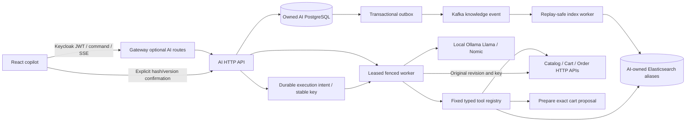

# Local Llama copilot architecture

<!--
Maintenance: Explains local inference, durable runs and evidence flow across service boundaries.
-->

CommerceFlow's independently deployable `ai-service` uses Spring AI's low-level Ollama API with pinned
`llama3.1:8b` and a separate `nomic-embed-text:latest` embedding model. There is no cloud inference fallback.
The existing Java 25 / Spring Boot 4.1.1 BOM remains authoritative; the AI BOM is scoped to the AI module.

`api` owns validation, caller identity and HTTP/SSE. `application` owns the bounded worker, expiring process-local
credential attachment and action executor. `persistence` uses short local transactions for run claims, checkpoints,
proposals and execution audit. `retrieval` and `indexing` own curated sources and their derived search projection.
`model` limits local inference; `tools` validates fixed schemas and calls only configured service addresses.
No AI code reads another service's tables or shares JPA entities.

Knowledge imports persist source versions, deterministic section chunks, jobs and outgoing events in one PostgreSQL
transaction. Kafka delivery is at least once and transactionally deduplicated. The projector acknowledges Elasticsearch
before marking a job complete, uses external source versions/tombstones and serializes live projection/rebuilds with
a session advisory lock. It never keeps a database transaction open across external HTTP. Retained old index generations
support diagnosis; source version/audience checks against PostgreSQL protect against stale projections.

Retrieval fuses BM25 and dense-vector candidates locally using reciprocal ranks. Its vector scan is suitable for this
bounded demo corpus, not an asserted large-corpus capacity result. An embedding failure produces an explicit lexical
fallback; generation failure produces bounded retries and a visible failure. Product prices/versions and order causes
come from authenticated live APIs. Generic policy text cannot establish an actual order's cancellation cause.

Runs move through QUEUED, RUNNING, optional WAITING_CONFIRMATION/AUTHENTICATION_REQUIRED/RETRY_WAIT, and a terminal
SUCCEEDED/FAILED/CANCELLED state. PostgreSQL claims use `SKIP LOCKED`; a 15-second renewable lease and increasing fence
reject stale commits. The worker renews every three seconds, accounts active time and caps execution at 120 seconds.
It checkpoints safe model outputs/tool requests and observable tool results, never hidden reasoning. Model calls can
regenerate after interruption; byte-for-byte LLM replay is not promised. Privileged reads refresh after recovery.
A restart loses caller credentials and requires the same owner/current role to resume.

The server admits eight queued/running/retrying runs and serializes each conversation. An application instance has one
run worker and one fair inference permit shared with embeddings. Four model rounds, eight tools, five-second tool
deadlines, 45-second inference HTTP timeouts, finite context and at most two transient retries limit resource use.
For this release, keep one AI application replica for the intended inference-capacity budget; leases/fences still
protect competing claims. Multi-instance inference admission would require an additional global capacity mechanism.

Proposals do not mutate commerce state. Confirmation persists one execution key before external dispatch; Cart's Lua
script checks its memo/hash first and its incarnation-aware `If-Match` second. The same request recovers a lost response
only within a shorter-than-memo retention horizon. Unknown outcomes require review. This is an auditable, recoverable
cross-store workflow, not an atomic PostgreSQL/Redis commit or a distributed exactly-once guarantee.

The browser renders untrusted text with React escaping and typed citation/proposal controls. Header-authenticated SSE
replays committed progress/final events and does not enqueue work. Partial token streaming is not implemented; a saved
final message is the completion boundary. Existing catalog/cart/checkout functionality remains independent of models.

The model-visible order explanation intentionally selects current public state/cause/version/observation, rather than
feeding the full timestamped timeline to generation. The full authorized Order API still exposes its history.
Rebuild recovery uses the already-held PostgreSQL session advisory lock as the serialization authority: once a crashed
session releases it, RUNNING work may replay immediately, including an alias swap committed before its final checkpoint.
The diagnostic lease is not an extra ten-minute restart delay. Owned proposal/execution resume bypasses model admission
because Cart reconciliation has no generation dependency; ordinary inference resume still requires pinned model
readiness.
