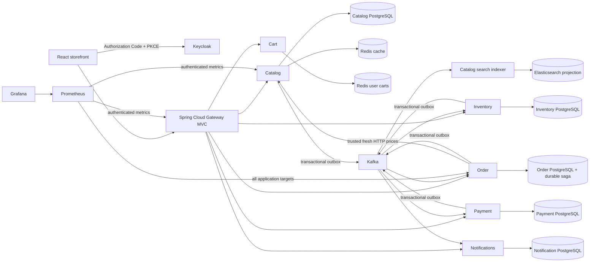

# Architecture

One PostgreSQL server hosts independently owned databases. Every business write, outgoing outbox row and consumer marker commits in its owning service's local transaction. Services share versioned DTOs and database-local infrastructure helpers, never JPA entities, foreign repositories or SQL joins.

Checkout states: PENDING_INVENTORY → AWAITING_PAYMENT → COMMITTING_INVENTORY → CONFIRMED. Insufficient stock cancels directly. Declined payment releases reserved stock before cancellation completes. Uncertain payment enters CANCELLING_PAYMENT, obtains a terminal cancellation/refund result, then releases inventory. Committing inventory retries commitment instead of releasing already-authorized stock. Cancellation tombstones prevent late reservation/authorization commands from taking stock or charging.

All applications validate JWTs independently, even behind the gateway. PostgreSQL is authoritative for money, stock and saga state. Redis outages degrade catalog display reads safely and fail carts explicitly; Elasticsearch outages fail search explicitly. Neither derived store supplies authoritative checkout prices.

App modules: catalog, cart, order, inventory, payment, notification and gateway. `contracts` is wire-only; `service-support` is infrastructure-only. `workflow-tests` launches real applications/infrastructure and has no production deployment role.
